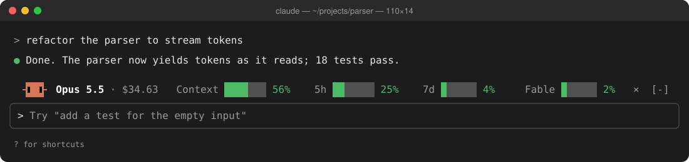
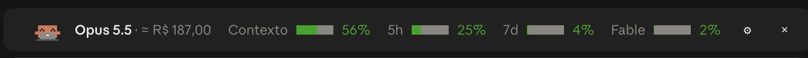
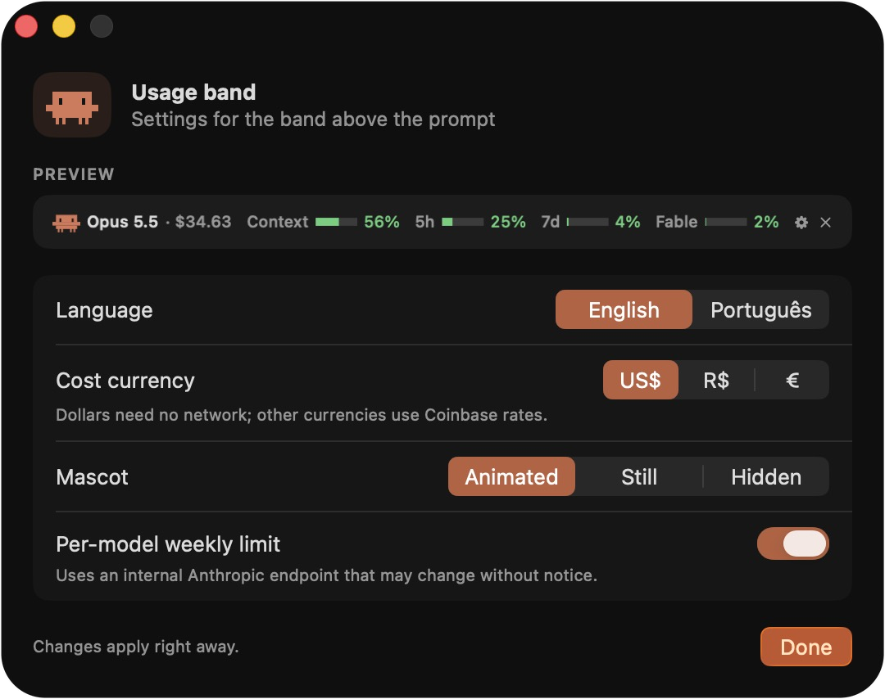

<div align="center">



# Usage Band

**A Claude Code mod that keeps your limits in sight: context window, 5-hour session, week and per-model usage, in one line above the prompt.**

[](https://github.com/jonathanlocks/usage-band-mod/stargazers)
[](LICENSE)
[](https://docs.claude.com/en/docs/claude-code)
[](#settings-window-macos)

[Install](#install) · [What it shows](#what-it-shows) · [Meet the mascot](#meet-the-mascot) · [What leaves your machine](#what-leaves-your-machine) · [Settings window](#settings-window-macos)

<br>



<sub>In the terminal: drawn from the band's real output at 110 columns.</sub>

<br><br>



<sub>In the Claude desktop app.</sub>

</div>

---

**Status:** early release (0.2.0), maintained by one person. Tested on macOS 26.6 with Claude Code 2.1.302, in the terminal and in the desktop app. The band works anywhere Claude Code runs; the settings window needs macOS 26.

## What it shows

- **Model and session cost.** The cost is what the session would cost at API prices. On a Pro or Max subscription it is an equivalent, not a charge. Show it in US dollars, Brazilian reais or euros; converted values are marked `≈` because they use market rates, not what your card charges.
- **Context window** used by the current session.
- **5-hour session and weekly limits** of your subscription. These two bars only appear in subscription sessions; with an API key, Bedrock or Vertex they stay hidden instead of sitting empty.
- **Per-model weekly limit**, such as Fable, when your account has one.
- **Colors** follow the level: green below 60%, yellow from 60%, red from 85%.
- **Narrow terminals** keep the line on one row. Space runs out in this order: the reset times, then the bars, then the cost, the mascot and the model, and only then the last bars.
- **Reset times** next to each bar (`↻ 2h 10m`) when the line has room.

## Meet the mascot

A pixel crab sits at the start of the band and runs through 13 gestures in a 56-second loop. Pick animated, still or hidden; it stays still when your system asks for reduced motion.

| | | | | |
|:-:|:-:|:-:|:-:|:-:|
| <br><sub>Laptop</sub> | <br><sub>Coffee</sub> | <br><sub>Dance</sub> | <br><sub>Shades</sub> | <br><sub>Party</sub> |
| <br><sub>Nap</sub> | <br><sub>Crab walk</sub> | <br><sub>Heart</sub> | <br><sub>Idea</sub> | <br><sub>Peekaboo</sub> |
| <br><sub>Wave</sub> | <br><sub>Hop</sub> | <br><sub>Look around</sub> | | |

## Install

In Claude Code, in a terminal:

```
/plugin install usage-band-mod --marketplace jonathanlocks/usage-band-mod
```

In the Claude desktop app, where `/plugin` is not available: click **+** next to the prompt box, then **Plugins**, **Add marketplace** with `jonathanlocks/usage-band-mod`, then **Add plugin**.

From a shell:

```bash
claude plugin install usage-band-mod --marketplace jonathanlocks/usage-band-mod
```

The install screen asks for the options below. Change them later in `/config`, under `usage-band-mod`, or in the settings window on macOS.

## Commands

| Command | What it does |
|---|---|
| `/usage-band` | Shows or hides the band. The `×` on the band hides it too. |
| `/usage-settings` | Opens the settings window (macOS 26). In the desktop app, the ⚙ on the band does the same. |

With the language set to Portuguese, the commands are `/uso-barra` and `/uso-ajustes`.

## Options

| Option | Values | Default |
|---|---|---|
| Language | `en`, `pt` | `en` |
| Currency | `USD`, `BRL`, `EUR` | `USD` |
| Mascot | `animado` (animated), `parado` (still), `oculto` (hidden) | `animado` |
| Per-model weekly limit | on, off | on |

## What leaves your machine

| Where | When | What |
|---|---|---|
| `api.anthropic.com/api/oauth/usage` | At most every 10 minutes, only with the per-model limit on | A GET with your subscription login. Claude Code attaches the token; the mod never sees it. |
| `api.coinbase.com/v2/exchange-rates` | At most every 6 hours, only when the currency is not USD | A GET with no login. After a failure it waits 5 minutes, then 30 minutes, then 2 hours. A rate older than 3 days is not used. |

Nothing about your conversations, projects or files is sent. With `CLAUDE_CODE_DISABLE_NONESSENTIAL_TRAFFIC` set, the mod makes no requests at all.

> [!NOTE]
> The per-model limit reads an internal Anthropic endpoint with no public documentation. It can change or stop working without notice; if it does, that bar disappears. Turn the option off if you would rather not use it.

## When to use something else

- For a one-off look at your limits, Claude Code's own `/usage` is enough.
- For reports across past sessions and days, use a log analyzer such as [ccusage](https://github.com/ccusage/ccusage). This mod only shows the current session and your live limits; it keeps no history.

## Settings window (macOS)



`macos/PainelDeUso.app` is a small SwiftUI app built from [`macos/Sources/PainelDeUso.swift`](macos/Sources/PainelDeUso.swift). It does not use the network. It talks to the mod only through standard output, one JSON line per change, and changes apply to the band right away. Its only file output is a PNG, and only when you run it by hand with the developer flag `--print`.

The repository ships the app already built (universal, ad-hoc signed), so you do not need Xcode. To check that the shipped app matches this source, build it yourself; the script ends by comparing your build with the published SHA-256 in `macos/PainelDeUso.sha256` and prints `OK` or `FAILED`:

```bash
./macos/build.sh
```

The published hash comes from Swift 6.4 (Xcode command line tools with the macOS 26 SDK). Another Swift version can produce a different binary, and then the check fails even though the source is the same.

On Windows, Linux or macOS before 26, use `/config`. The options are the same.

## Development

```bash
claude plugin validate .
claude plugin test .
claude --plugin-dir .
```

The mascot is drawn frame by frame in [`arte/gerar_mascote.py`](arte/gerar_mascote.py):

```bash
python3 arte/gerar_mascote.py            # writes hooks/mascote.ts
python3 arte/gerar_mascote.py --previa   # also writes arte/previa.html with every gesture
python3 arte/gerar_mascote.py --check    # fails if hooks/mascote.ts is out of date
```

`tsconfig.json` extends `.claude-plugin/types/tsconfig.json`, which Claude Code writes the first time it loads the mod. On a fresh clone, load the mod once before running `tsc`.

Changes are listed in [CHANGELOG.md](CHANGELOG.md).

## Star history

<a href="https://star-history.com/#jonathanlocks/usage-band-mod&Date">
  <picture>
    <source media="(prefers-color-scheme: dark)" srcset="https://api.star-history.com/svg?repos=jonathanlocks/usage-band-mod&type=Date&theme=dark">
    <source media="(prefers-color-scheme: light)" srcset="https://api.star-history.com/svg?repos=jonathanlocks/usage-band-mod&type=Date">
    
  </picture>
</a>

## License

The code is [MIT](LICENSE). The mascot drawings are fan art of Clawd, the Claude Code mascot, and are not covered by the MIT License.

This is an independent project, not made, endorsed or supported by Anthropic. Claude, Claude Code and Clawd are trademarks of Anthropic.
